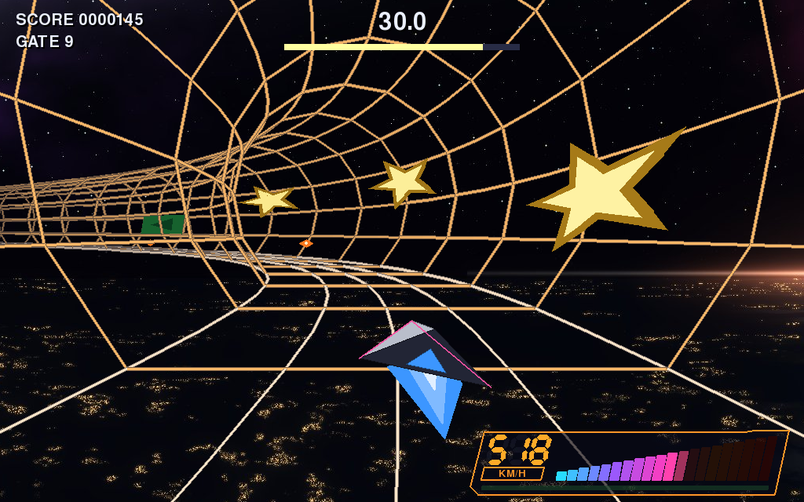
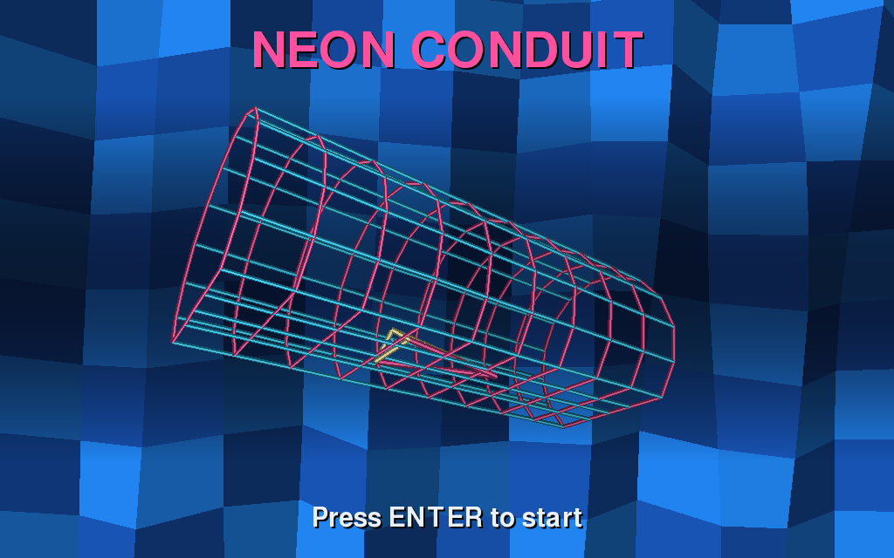
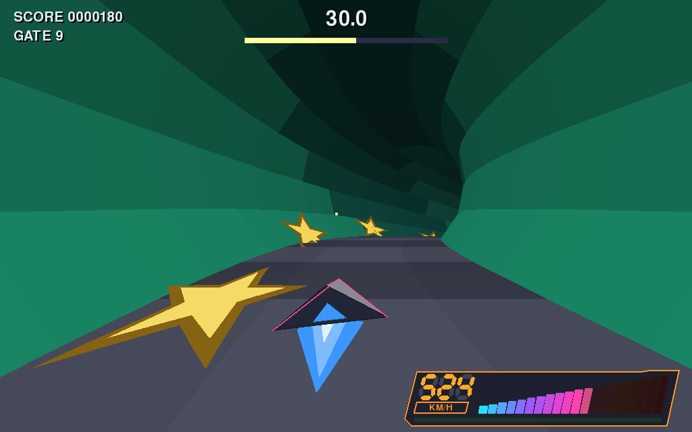
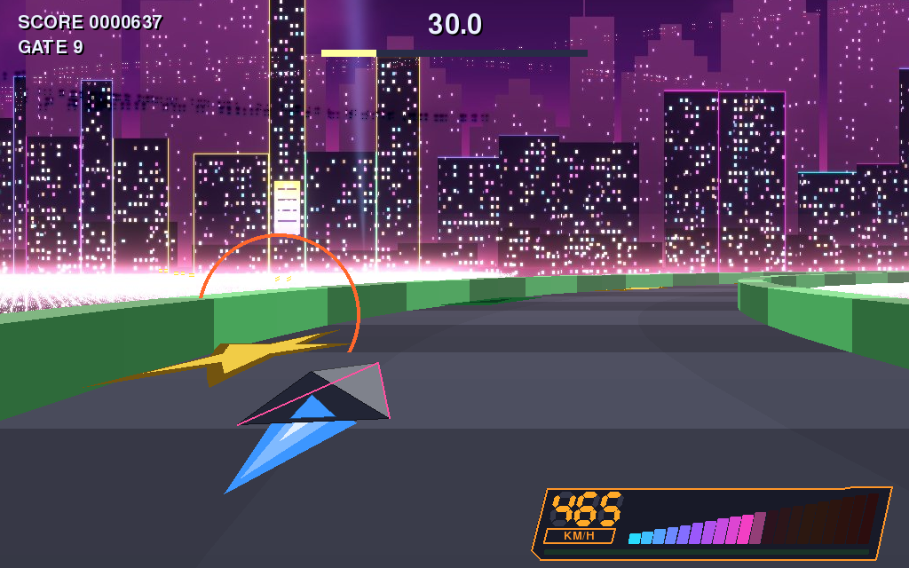
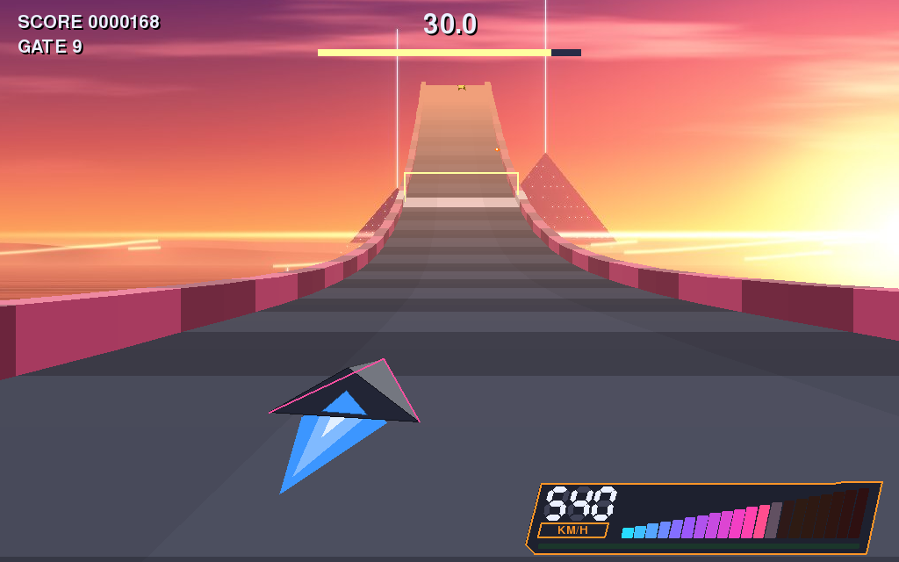
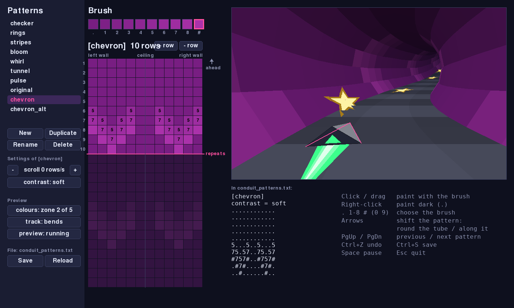
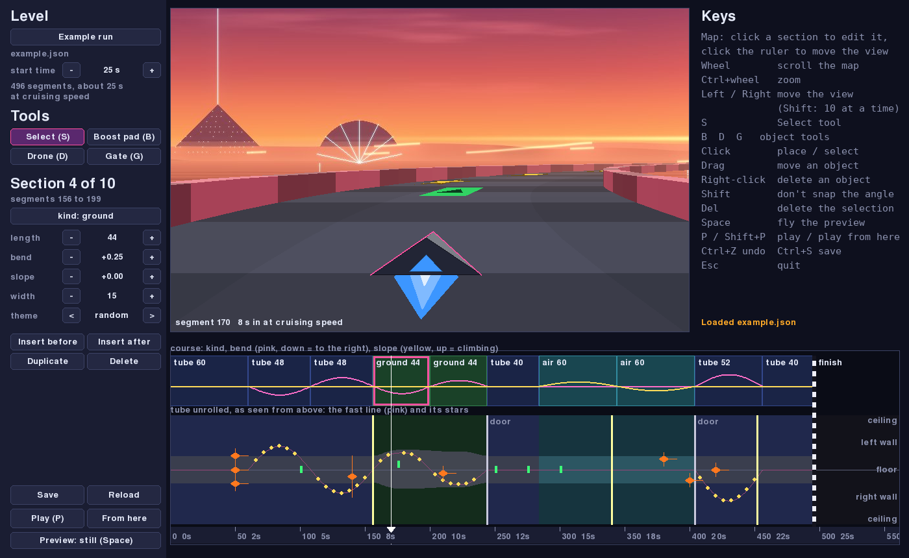

# Neon Conduit

**A neon tunnel racer, written in Python with pygame.**

Fly a hover sled down an endless tube that's different every run. Take the
outside of each bend to keep your speed, hit the boost pads, shoot the
drones, and reach the next gate before the clock runs out.



## Features

- **An endless track that's generated as you go**, the same every time for a given seed.
- **Ride the walls:** the tube is a full circle. Steer up the side and you can loop right
  round the ceiling.
- **A fast line through every bend**, up the outside wall and marked with stars. Stray off
  it and you lose speed.
- **Tunnels with patterns:** each stretch of tunnel gets a random wall pattern (checker,
  bloom, whirl, chevrons…) in its own colours.
- **Outdoor runs**, which come in two kinds:
  - *ground-level*: a flat road between kerbs, past a neon city, desert dunes or a glacier;
  - *in the air*: a see-through wireframe tube with a planet far below.
- **Sliding doors** close the tube off behind each outdoor run, opening as you arrive.
- **Boost pads, drones and twin guns**, with Up / Down to aim your shots.
- **An engine you can hear:** a low hum while the sled stands still, rising in pitch as it
  speeds up and highest at full boost.
- **A pattern editor** to design your own tunnel walls, with a live preview.
- **A level editor** to build your own courses, with a finish line, and race them.
- **No sound files:** every sound effect is generated by the game itself.

## Screenshots

| | |
|---|---|
|  |  |
|  |  |

## Getting started

You need Python 3 and [pygame-ce](https://pyga.me/), the community edition of pygame.

```sh
git clone https://github.com/nnovic/neon_conduit.git
cd neon_conduit
pip install -r requirements.txt
python3 play.py
```

`python3 -m neon_conduit` starts the game too.

> **Note:** pygame-ce and the original `pygame` package both install a module called
> `pygame`, so they clash. If you have `pygame` installed, uninstall it first.

### Command-line options

| Option | What it does |
|---|---|
| `--seed N` | Race a fixed track: the same seed always gives the same course |
| `--fullscreen` | Start in full screen (F11 switches back and forth) |
| `--frames N` | Let the auto-pilot play N frames, then quit (for testing) |
| `--screenshot FILE` | With `--frames`, save the last frame as an image |
| `--fps` | Show frames per second and frame time (F3 switches it on and off) |
| `--level FILE` | Race a hand-made level (see [the level editor](#the-level-editor)) to its finish line |
| `--from SEG` | With `--level`, start at this segment of the level |

## How to play

| Key | Action |
|---|---|
| ← / → or A / D | Steer round the tube |
| ↓ / ↑ | Aim higher / lower |
| Space | Fire (one shot per press) |
| P | Pause |
| F11 | Full screen on / off |
| F3 | Frames per second and frame time on / off |
| Enter | Start / race again |
| Esc | Quit |

- **The clock:** you start with 25 seconds. Each gate you reach adds more time and
  1,000 points, and the game ends when the clock reaches zero.
- **Bends:** the fast line runs up the outside wall. The gold stars mark it, and each one you
  ride through is worth points. Cut the inside and you slow down.
- **Boost pads:** green pads give a few seconds of extra speed.
- **Drones:** shoot one for 500 points. Fly into one and you lose most of your speed.
- **Speed:** each gate raises your cruising speed and brings more drones.

## The pattern editor



```sh
python3 edit_patterns.py
```

The tunnel wall patterns are stored in plain text in
[`neon_conduit/conduit_patterns.txt`](neon_conduit/conduit_patterns.txt). Each row of the
grid is one track segment, and each column one of the 12 wall panels round the tube. Paint
cells with the mouse, shift the whole pattern with the arrow keys, and set how fast it
scrolls and how strong its contrast is. The preview flies down a tunnel painted with your
pattern as you edit. Save with Ctrl+S, and the game picks the pattern up next time it starts.

You can also edit the file by hand: its header explains the format.

## The level editor



```sh
python3 edit_level.py levels/example.json     # or a new file, to start from scratch
python3 play.py --level levels/example.json   # race it
```

A level is a finite course with a finish line: reach it before the clock runs out. Gates
add time, as in the endless race, and every second left at the finish scores.

Along the bottom is the map of the course, from the start on the left to the finish line on
the right:

- **The sections**, in order. Click one to edit it in the panel on the left: its kind (tube,
  ground-level road, or see-through tube in the air), length, bend, slope, the road's width,
  and the tube's wall pattern or the outdoor run's theme (or random). Insert, duplicate or
  delete sections there too; what is on the track moves along with its section.
- **The tube unrolled**, as seen from above: the floor along the middle, the left wall above
  it, the right wall below, the ceiling at the edges. It shows the fast line with its hint
  stars, the doors, and the objects. Pick a tool (boost pad, drone, gate) and click to place
  one; with the Select tool, click one to edit its settings, drag it to move it. Right-click
  deletes it.

The preview above shows the game's view from the cursor: click the ruler to move it, or
press Space to fly through. P races the level as it is in the game, Shift+P from the cursor.
Levels are saved as JSON (Ctrl+S); [`neon_conduit/level.py`](neon_conduit/level.py)
explains the format.

## Developer mode

Set `DEVELOPER_MODE = True` in [`neon_conduit/config.py`](neon_conduit/config.py) to draw
the fast line on the track, and brackets round the drone your guns are locked on to. The
other settings in that file control the tube, the track, the physics and the timing.

## Tools

| Script | What it does | Extra requirements |
|---|---|---|
| [`tools/make_ship.py`](tools/make_ship.py) | Builds the racer model, `neon_conduit/assets/ship.obj` (a plain Wavefront OBJ, which Blender can open) | — |
| [`tools/engine_sound.py`](tools/engine_sound.py) | Plays the racer's engine endlessly at a speed you pick on a slider, to tune its sound | — |
| [`tools/make_panoramas.py`](tools/make_panoramas.py) | Paints the 360° outdoor backdrops, `neon_conduit/assets/sky_*.jpg` | numpy |
| [`promo/make_ad.py`](promo/make_ad.py) | Renders a short vertical promo video, using the game's own engine | GStreamer (`gst-launch-1.0`, x264enc, mp4mux) |

## Project layout

```
play.py                 start the game
edit_patterns.py        start the pattern editor
edit_level.py           start the level editor
levels/                 hand-made levels (example.json)
neon_conduit/
  app.py                window, main loop, command line
  game.py               rules and physics (no drawing, no keyboard)
  track.py              the endless, procedurally generated track
  render.py             3D drawing of the world, projected by hand
  decor.py              the 360° backdrops of the outdoor runs
  themes.py             themes of the outdoor runs, read from outdoor_themes.txt:
                        backdrop, ground or air, horizon, fog, weight, kerb colours
  title.py              the title screen: flag and wireframe tunnel
  hud.py, speedo.py     head-up display and speedometer
  patterns.py           tunnel wall patterns, read from conduit_patterns.txt
  editor.py             the pattern editor
  level.py              hand-made levels: the file format, and their tracks
  level_editor.py       the level editor
  model.py              loads the racer's OBJ model
  audio.py              generated sound effects, and the music
  geometry.py, palette.py, config.py
  assets/               the racer model, the backdrops, the title font and music
tools/                  scripts that build the assets
promo/                  the promo video generator
```

## Credits

The title music is "Hero Immortal" by Trevor Lentz, and the title is set in
[Russo One](https://fonts.google.com/specimen/Russo+One) by Jovanny Lemonad. See
[CREDITS.md](CREDITS.md) for their sources and licenses. Everything else (the models,
the backdrops, the sound effects) is generated by this project's own code.
